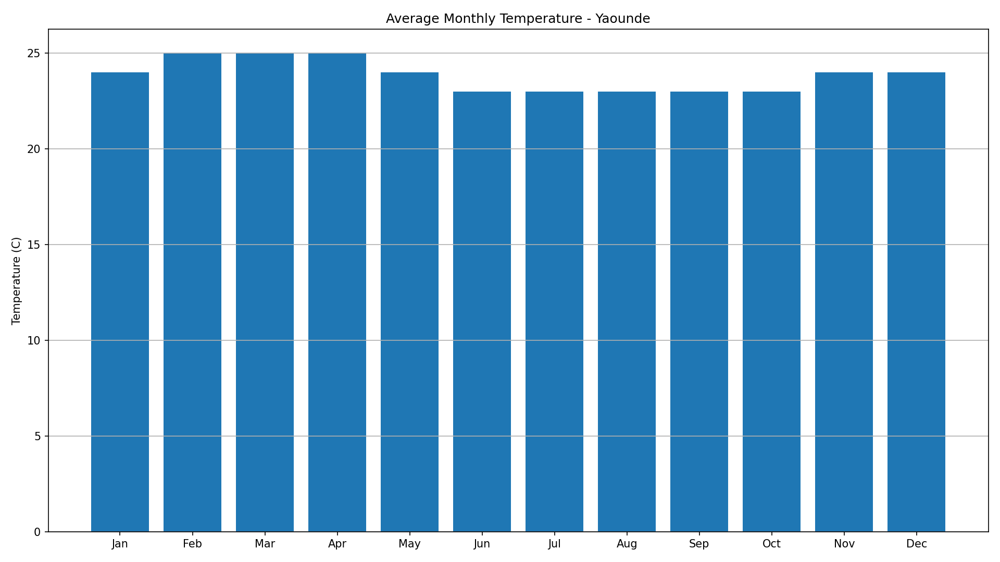
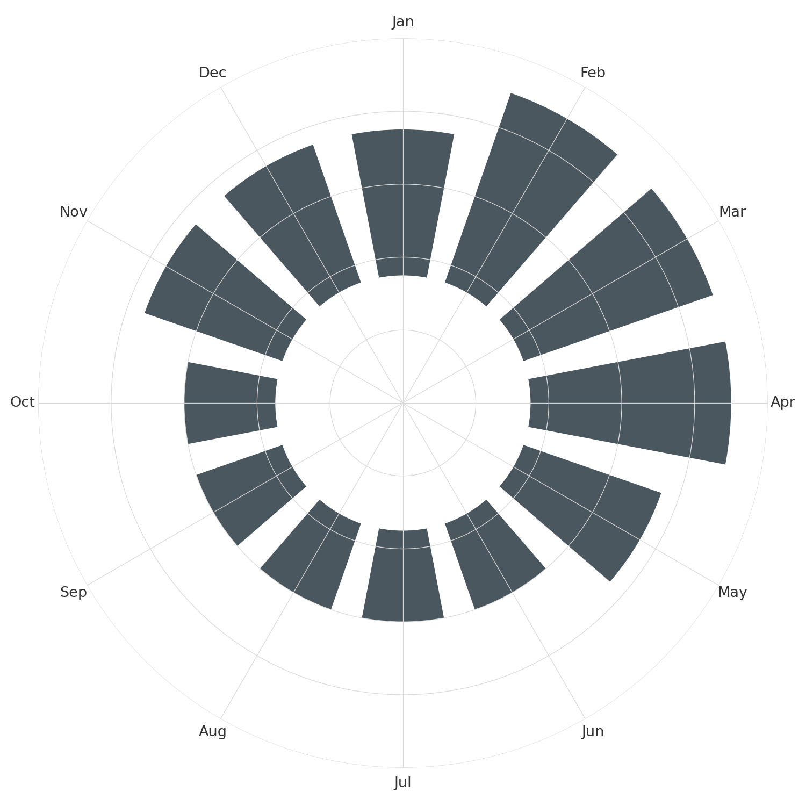
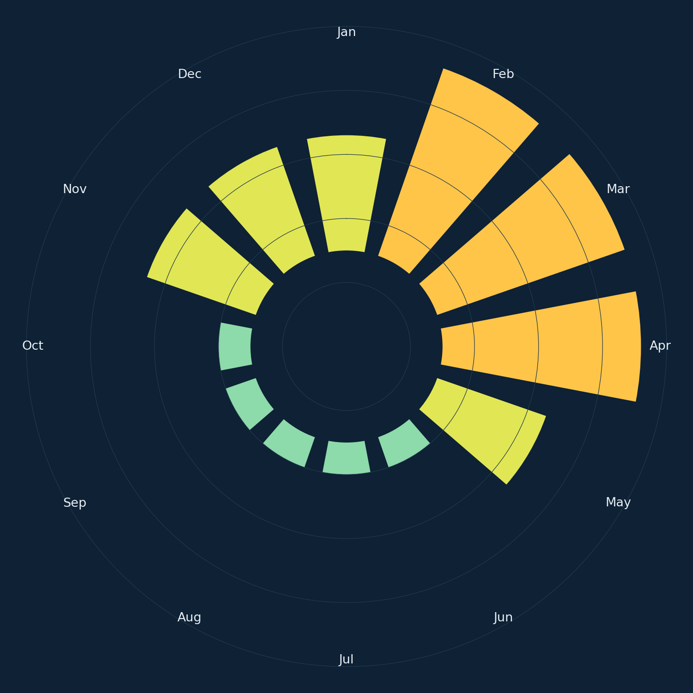
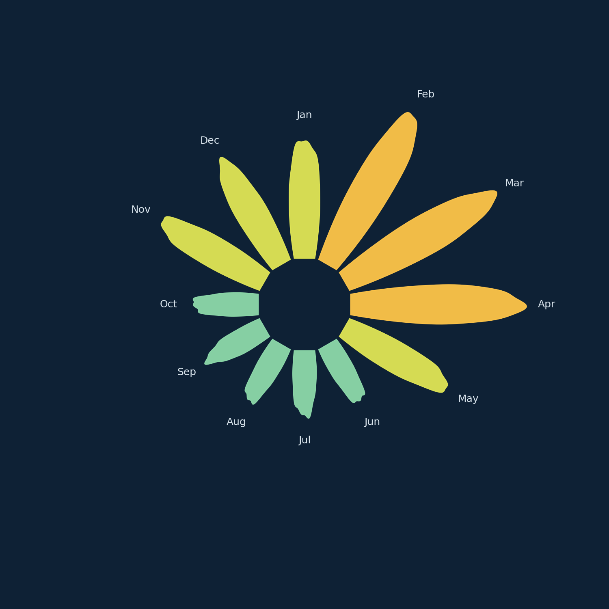
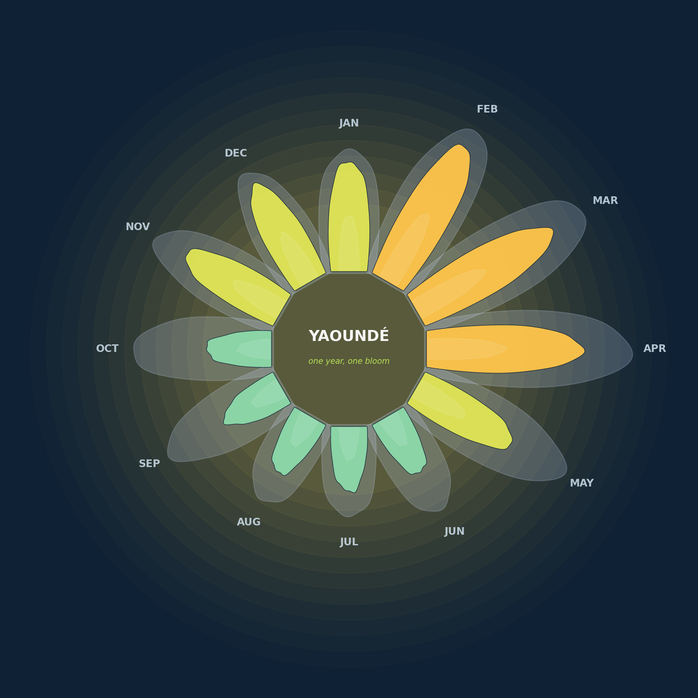

# Creative Coding with Matplotlib: Turning Data into Art

Companion code for my talk at **PyCon Cameroon 2026** (Yaoundé).

Most of us learn Matplotlib for formalities — plotting a graph, drawing a
bar chart, getting an assignment done. This repo walks through the same
demo shown in the talk: one dataset, transformed step by step from a
default `ax.bar()` chart into something intentional.

> Making something beautiful is a legitimate reason to write code.

## What's in here

The demo takes a single dataset — **Yaoundé's average monthly temperature
and rainfall** (WorldClim climate normals, 1970–2000) — and applies one
change at a time:

| Step | What happens | Script |
|---|---|---|
| 1 — The honest default | `ax.bar()` once: default blue, boxed spines, full grid, generic title | `src/step1_the_default.py` |
| 2 — Strip the defaults | Remove the spines, quiet the grid — and swap the rectangle for a circle (`projection="polar"`) | `src/step2_strip_defaults.py` |
| 3 — Choose intentionally | Color mapped straight from temperature (cool blue → warm orange) on a dark canvas | `src/step3_choose_intentionally.py` |
| 4 — Let the shape follow the data | Bars become petals: one small `petal()` function, called once per month | `src/step4_shape_follows_data.py` |
| 5 — Compose the page | Rainfall as a second, translucent layer of petals, plus a title in the middle of the bloom | `src/step5_compose_the_page.py` |

Plus a bonus diagram used earlier in the talk to explain matplotlib's
object model:

| Diagram | What it shows | Script |
|---|---|---|
| Figure/Axes anatomy | The Figure vs. Axes object model, spines, ticks | `src/anatomy_diagram.py` |

### The five steps, side by side

| Step 1 | Step 2 |
|---|---|
|  |  |

| Step 3 | Step 4 |
|---|---|
|  |  |

| Step 5 |
|---|
|  |

Same data. Same library. A different intention every time.

## The idea behind Steps 4 and 5

Steps 1–3 are subtraction and mapping. Step 4 is where it stops being a
chart, and it works the same way every time:

```
DATA  →  PARAMETERS  →  VISUAL RULES  →  ARTISTIC OUTPUT
temp     petal length    petal(): a lens   a flower
rain     petal layers    shape + a ripple
```

The numbers aren't plotted and then decorated — they're fed into a small
function (`petal()`, in `src/step4_shape_follows_data.py`) that is written
once and called twelve times.

## Repo structure

```
creative-coding-with-matplotlib/
├── README.md
├── requirements.txt
├── .gitignore
├── assets/                          # pre-rendered images (for this README)
│   ├── anatomy_figure_axes.png
│   ├── chart_step1_plain.png
│   ├── chart_step2_stripped.png
│   ├── chart_step3_intentional.png
│   ├── chart_step4_petals.png
│   └── chart_step5_final.png
├── src/
│   ├── data.py                      # shared dataset + color helpers — imported by every step
│   ├── step1_the_default.py
│   ├── step2_strip_defaults.py
│   ├── step3_choose_intentionally.py
│   ├── step4_shape_follows_data.py  # defines petal() — step 5 imports it
│   ├── step5_compose_the_page.py
│   ├── anatomy_diagram.py
│   └── run_all.py                   # runs every script above in order
└── output/                          # created when you run a script (git-ignored)
```

`assets/` holds the images already used in the slides, so you can browse
the result on GitHub without running anything. `output/` is where the
scripts save fresh copies when you run them yourself.

## Setup

Requires Python 3.9+.

```bash
git clone https://github.com/<your-username>/creative-coding-with-matplotlib.git
cd creative-coding-with-matplotlib

python3 -m venv venv
source venv/bin/activate          # Windows: venv\Scripts\activate

pip install -r requirements.txt
```

## Running it

Each step is a standalone script and can be run on its own:

```bash
cd src
python step1_the_default.py
python step2_strip_defaults.py
python step3_choose_intentionally.py
python step4_shape_follows_data.py
python step5_compose_the_page.py
python anatomy_diagram.py
```

Or run everything at once:

```bash
cd src
python run_all.py
```

Each script prints the path it saved to, under `../output/`.

## Try it with your own data

The whole demo is driven by two lists in `src/data.py`: `temp` and `rain`,
twelve values each. Swap in your own city (or anything that repeats over a
year) and re-run — every step re-renders around your numbers. Petal sizes
and the temperature colors rescale on their own.

A few things worth playing with once it runs:

- Change `wobble` in `petal()` to make petals smoother or wilder.
- Change the colors in `data.py` and see how the mood shifts.
- Map a third variable to something new — petal width, opacity, a ring.

## Why static demo, not live coding

The talk shows this demo as static slides rather than live-coding it —
a deliberate choice for a first conference talk. This repo is the
live-coding version for anyone who wants to actually run it, tweak the
data, or reuse the pattern on their own charts.

## A note on the data

The values in `src/data.py` are Yaoundé's climate normals (WorldClim,
1970–2000) as tabulated by populationreview.org, rounded to whole degrees
and millimetres — good for a demo, not a substitute for the original
dataset. For a similarly-sourced, independently verifiable dataset, see
the UEA Climatic Research Unit's Cameroon page (the one linked on the data slide).

## License

MIT — reuse the code, the pattern, or the whole demo freely.
